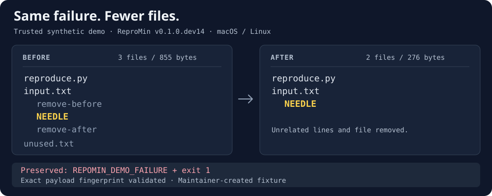

# Inspect a reduction before installing

The built-in demo runs the real reducer on a small, trusted fixture. This
preview shows what it removes and what the result still does. It is a
maintainer-created synthetic example, separate from the
[real-project case studies](../README.md#evidence-so-far).



## What survives

On macOS/Linux, the demo creates three source files:

```text
source/
  reproduce.py
  input.txt
  unused.txt
```

`input.txt` starts with three lines. `reproduce.py` emits
`REPOMIN_DEMO_FAILURE` and exits with code `1` only when a complete line is
`NEEDLE`; without it, the script emits a different message and exits `2`.
The reducer must preserve both the target message and exit code.

```diff
-remove-before
 NEEDLE
-remove-after
```

The result keeps `reproduce.py` and an `input.txt` containing only `NEEDLE`
and its newline. It deletes `unused.txt` entirely. The source directory is
retained alongside the result, so you can compare them.

## Run it

With Python 3.9+ and [uv](https://docs.astral.sh/uv/getting-started/installation/)
0.13.4 or newer, run this exact pre-alpha development version in a new
workspace. Keep uv up to date as described in the
[Python security notice](https://discuss.python.org/t/information-for-python-users-regarding-emudhra-emsign-ca-certificate-security-incident/109576).
These commands use Bash/Zsh on macOS/Linux:

```sh
uvx --from "https://github.com/fly1d/repomin/releases/download/v0.1.0.dev15/repomin-0.1.0.dev15-py3-none-any.whl" \
  repomin demo ./repomin-demo
```

This does not install into the project's Python environment. The first
invocation downloads the tool; the fixture and reduction need no network,
project dependencies, or API key. An existing workspace is never overwritten.
Choose another directory if `repomin-demo` already exists.

The macOS/Linux result has this layout:

```text
repomin-demo/
  source/                      original three files
  reduced/
    reproduce.py               unchanged failure script
    input.txt                  NEEDLE plus a newline
  reduced.repomin/
    report.json                recorded reduction evidence
    REPOMIN.md                 human-readable reduction receipt
```

The demo checks the exported payload's exact fingerprint automatically.
The observed macOS/Linux output for `v0.1.0.dev14` includes:

```text
Reduced: 3 files / 855 bytes -> 2 files / 276 bytes in 14 attempts.
Removed: unused.txt and two unrelated input lines.
Kept: reproduce.py and input.txt (only NEEDLE remains).
Validated: exact payload fingerprint.
```

On Windows, the fixture uses `reproduce.ps1`, so file names and byte counts
differ. See the [PowerShell walkthrough](QUICKSTART.windows.md).

## Try a real failure

A small fixture demonstrates the mechanics. A useful bug reproduction also
needs a failure signal that rejects setup errors and unusable results. Start
with the [real-repository quick start](QUICKSTART.md), or
[reply in the public pilot thread](https://github.com/fly1d/repomin/issues/11)
with a licensed repository and exact revision, reproduction command, and
target failure signal. No installation or completed report is required for
that initial fit check.

For an inspectable real-project result, browse the
[public tsdown fixture](https://github.com/fly1d/tsdown-css-modules-bug-report/tree/69801202853e56c5e4e970145cbef86aab14007d)
and its [case study](CASE_STUDY_TSDOWN_979.md). The validated payload had eight
files; its public presentation adds a README and `.gitignore`. It was a
maintainer-run feasibility trial, not evidence of independent adoption.

ReproMin is pre-alpha. Its default host backend executes the supplied command
with your account; only use repositories and commands you trust. A payload
fingerprint verifies bytes, while [replay](REPLAY.md) executes a command to
check the failure in fresh copies. Neither proves a globally minimal result
or diagnoses the bug.
